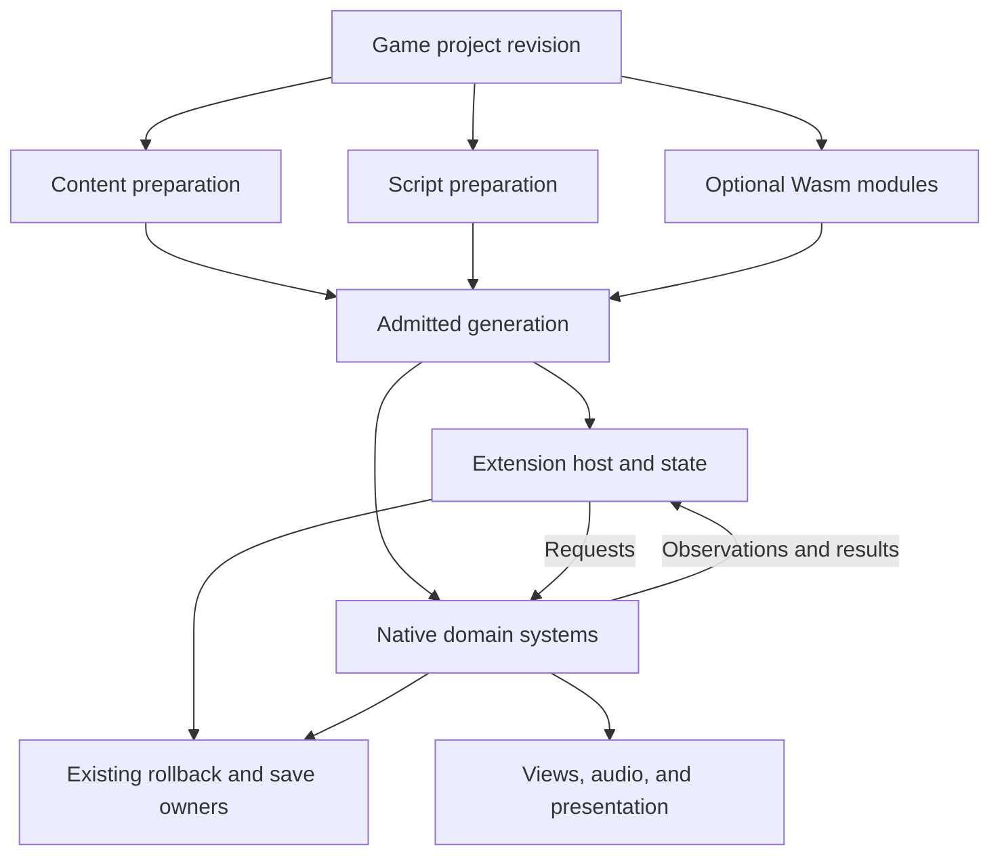

# Architecture for games authored without native builds

**Proposal for source snapshot `34f03976b639`.** The current engine facts are detailed in the three audit chapters. The interfaces and commands marked as proposed below are design sketches, not APIs present in this snapshot.

## 1. Change the unit of game delivery

The author should select an installed engine runtime and open a game project. That project contains the game's authored truth. Its preparation result is a loadable generation. A game author should be able to create rooms, characters, encounters, effects, dialogue, and procedural behavior without making a new Rust application.

The current native SDK already hides much of the plugin order through `PlatformerApp` and `GameModule`. However, a consumer still implements `GameModule::manifest` and `define` in Rust. The flagship shell installs its providers with native plugin calls. Outlander also authors its room and behavior in Rust. These are useful native extension surfaces, but they do not establish the runtime-project product. Source: `crates/ambition_platformer2d/src/app.rs:573`, `:810`; `game/ambition_app/src/app/shell_host.rs:100`; `fixtures/external_consumer/src/lib.rs:116`.

A project loader should lower a runtime manifest into the same inert composition and provider preparation model. It should not create an alternate scene constructor. The reusable engine host supplies a reviewed set of native services. The project selects supported services and provides data and behavior within that set. The existing native SDK remains available when an engine integrator needs a new service.

### The authoring contract

| Edit class | Normal operation | Native engine build |
| --- | --- | --- |
| Level geometry, placements, character tuning, moves, dialogue, music, art source | Existing authoring tools, validate, prepare, reload or reconstruct the scenario | None |
| New game algorithm using installed services | Edit script source; the host parses and prepares it; publish a generation | None |
| New state fields for a script | Edit the module state declaration; validate its schema and migration/lifetime policy | None when supported schema kinds and save roads suffice |
| New effect or body-form definition | Edit data within the installed effect/form vocabulary | None after those vocabulary gaps are closed |
| Rust module implementation | Build that module and load the artifact | No host rebuild on the loaded-module path; a module build still occurs |
| New collision solver, render pass, or native domain service | Extend native engine code, build a new runtime, then expose its contract | Expected |

“Without compilation” means that the author does not run Cargo, rustc, a C++ toolchain, or an external script build step for ordinary game edits. Parsing, validation, internal bytecode/AST preparation, shader compilation, and asset production can still occur. They must be visible, scoped work in the authoring loop. It would be misleading to promise that loading executable text requires no processing.

### Runtime products and optional capabilities

Ship an engine executable, its validator, inspection tools, and capability metadata as a matched version. A small set of supported runtime profiles can serve headless tests, ordinary visible platformers, and richer action games. Avoid building an engine for each content edit to obtain a smaller feature selection.

Distinguish four facts in discovery: a capability known by the SDK, compiled into this host, installed in this project, and ready for the active generation. Runtime selection cannot activate native code absent from the executable. A declared script requirement must fail clearly if its service is unavailable.

This permits an optimized engine during authoring. The binary can stay unchanged while the project changes. Native build cost then belongs to engine installation or development rather than every game edit.

## 2. Preserve one path for simulation authority

The existing extension boundary is the correct starting point. A procedural entry reads a declared observation cut, changes its own state, and submits domain requests. The native domain owns movement, contact, damage, custody, spawning, and other outcomes. The existing rollback system owns the state history.



The diagram shows the proposed project-level join. The source already implements the content, host, domain, and rollback paths separately. A single selected revision spanning a multi-file code/data/schema change remains an acceptance gap; this audit has not demonstrated a corruption bug in the present paths.

### Three kinds of behavior

A **controller** produces intent and yields to the actor's current control owner. The current `actor_think` hook is a controller hook. Its exclusion of driven actors is appropriate for that purpose.

A **body behavior** acts under its attachment and capability policy. A sticky coating, timed shield, contact reaction, or carried-object behavior may remain active when control changes from AI to a person. It should not have to occupy the actor's brain key. Several independent behaviors should be attachable to one body.

A **coordinated rule** reasons about a declared set of actors or objects. The Primeval swallow/coconut mechanic is such a rule. Its source sorts birds, reserves participants and items, and uses shared custody. Replacing it with unrelated per-body callbacks would lose that coordination. Provide a scoped observation and keep custody conflict resolution in the native owner. Source: `game/ambition_content/src/primeval.rs:139`, `:370`; `crates/ambition_combat/src/extension/think.rs:42`; `crates/ambition_combat/src/extension/contact.rs:75`.

These roles share execution and state infrastructure. Their semantics determine their hooks, scopes, and result timing. Do not expose arbitrary Bevy scheduling as the normal scripting API.

### Composition belongs to each domain

Keep collision sweeps, safe resize, portal carving/transit, and final motion integration native. Expose supported requests and parameters. Scripts may compute a steering algorithm or a desired trajectory; the movement owner checks and applies the result.

Keep effect families typed. Capability grants, numeric modifiers, invulnerability, item quantities, and periodic damage have different composition rules. The existing `AbilityContributions` is a useful source-owned model. Extend the selected numeric-effects work to stable runtime source/instance identities and explicit expiry. Ending one effect removes only its contribution. Canonical reduction order must cover floating-point operations.

Make body-form geometry prepared data where its semantics are ordinary resize and pose selection. Keep the transition operation responsible for clearance, feet anchoring, and dependent facts. A compact form with different dimensions should not require another `BodyMode` arm. A move-owned absence from the stage still needs an admitted semantic transition; replacing it with freely writable visibility/collision booleans would create competing authority. Source: `crates/ambition_platformer2d_core/src/player_state.rs:217`, `:374`; `crates/ambition_platformer2d_core/src/ability_projection.rs:20`; `crates/ambition_platformer2d_core/src/movement/model.rs:631`.

## 3. Language decision

### Recommendation

Build the first source-language adapter with **Rhai**, and retain the existing host contract as the language boundary. Treat this as a selected prototype direction with explicit acceptance, not a measured performance verdict or an irreversible public language commitment.

The engine already has a byte-based `ModuleBackend: Send + Sync` interface. Rhai is designed for embedding in Rust, documents browser/Wasm use, exposes operation limits, and supports the `sync` and `f32_float` configurations. These properties reduce the number of new integration systems needed for the first adapter. They do not establish correct engine bindings, target performance, or determinism. Sources: [Rhai Book](https://rhai.rs/book/), [Wasm builds](https://rhai.rs/book/start/builds/wasm.html), [features](https://rhai.rs/book/start/features.html), [operation limits](https://rhai.rs/book/safety/max-operations.html).

### Alternatives considered

| Candidate | Relevant strength | Cost or limit for this engine | Decision |
| --- | --- | --- | --- |
| Rhai | Direct Rust integration; configurable numeric and resource behavior; documented browser use | Dynamic typing gives less early feedback than Luau; binding and scenario checks remain important; runtime cost must be measured | First adapter candidate |
| Luau | Gradual types, strict mode, CLI analyzer, and embeddable interpreter | C/C++ integration; the common `mlua` binding documents Wasm through `wasm32-unknown-emscripten`, whereas Ambition uses `wasm32-unknown-unknown` | Keep as the specific alternative if type feedback or Rhai cost fails the acceptance case; prove target integration first |
| Lua | Small embedded-language model and established C API; explicit integer/float distinction | Dynamic types; host state, ordering, API metadata, and platform bindings still need engine work | No clear source-grounded reason to add alongside the first adapter |
| Existing Rust-to-Wasm | Implemented portable contract, typed source, isolated module build | Requires external compilation; current wasmi setup has per-call instance cost | Preserve as an optional compiled-module path; do not call it a faster runtime without measurement |
| New custom language | Can enforce engine-specific semantics directly | Adds parser, checker, diagnostics, tooling, runtime, and maintenance before proving the authoring API | Defer; define the engine contract independently of syntax |

Luau's strict mode and analyzer are meaningful advantages for an LLM author because errors can be reported before a gameplay path executes. Its documented embedding API also compiles source to bytecode internally, so it can meet the no-external-compiler author contract. The blocker is integration evidence for Ambition's actual target stack, not the concept of bytecode compilation. Sources: [Luau types](https://luau.org/types/), [Luau embedding and tools](https://github.com/luau-lang/luau/blob/master/README.md), [mlua target support](https://github.com/mlua-rs/mlua).

Do not infer LLM code quality from language popularity, and do not claim a comparative runtime speed from language documentation. The first stateful mechanic, diagnostic quality, and actual target execution should decide whether the candidate remains suitable. Keep one supported author-facing language initially. A language-neutral host does not require maintaining several public languages at once.

### Rhai adapter shape

Create an execution backend that owns immutable prepared programs, source positions, module descriptors, and binding metadata. It receives the current invocation, converts its declared values, creates fresh mutable invocation context, evaluates the entry, and returns the existing checked state/request encoding. Start through the byte interface to retain one validation path. A later typed in-process adapter is justified only if buffer conversion is measured to matter.

Use a fresh mutable scope for each invocation. Shared ASTs and immutable imports may be cached. Registered closures, custom values, module variables, and captured objects must not retain mutable gameplay state outside the host. Define top-level initialization explicitly; Rhai's default `call_fn` evaluates the AST before calling the entry. Skipping that step is an optimization that requires an immutable initialization/import model. Sources: [Scope](https://rhai.rs/book/engine/scope.html), [function calls](https://rhai.rs/book/engine/call-fn.html).

Do not serialize Rhai's heap or Scope as game state. Decode and encode the engine's schema-backed records. This keeps rollback, saves, inspection, and migration independent of the interpreter's object layout.

Pin the interpreter version, enabled features, binding schema versions, source/import digests, numeric functions, and budget policy in executable identity. Use explicit simulation time and RNG state. An operation limit must also bound native query/result work: a single host call can do much more work than one interpreter operation. Preserve source locations and translate faults into existing invocation rejection semantics. These requirements follow from the engine's deterministic contract; they are not a new general sandbox campaign.

## 4. Define a script SDK from domain-owned schemas

The current `Port` contract has an associated Rust value and manual encode/decode functions. It does not describe that value's fields. A useful script SDK needs one authoritative structural source beside each port. Generate its codec, conversion layer, schema output, and type/help metadata from that source. Keep semantic prose and rules explicit: scope, frame, units, phase, result meaning, and support conditions cannot be inferred from a Rust field type. Source: `crates/ambition_extension_sdk/src/port.rs:63`; `crates/ambition_extension_host/src/admission.rs:118`.

The smallest useful extension to that schema vocabulary includes records, enum cases, bounded sequences, and typed content/instance references. State currently has only primitive fields, options, and bounded sequences. Use opaque exact references rather than exposing entity allocator bits or converting 64-bit IDs through a script floating-point number. Resolve content IDs during preparation; resolve live/persistent references under the owning domain's lifetime rules.

The author-facing types should name reference frames. A body observation needs the relevant gravity/acceleration frame, local axes, velocity, and contact facts. A vector should state whether it is world-relative, body-relative, or view-relative. The present `ActorThink` value lacks those frame facts. A function named `move` with an unqualified vector would discard one of the engine's useful strengths. Source: `crates/ambition_combat_port/src/think.rs:25`.

### State and results

A script owns its schema-backed decision state. The engine owns the outcomes it requests. The current host commits records before downstream requests are lowered. Therefore a successful submission means that a request was staged. It does not prove pickup, spawn, teleport, damage, or resource spend succeeded. Source: `crates/ambition_extension_host/src/exec.rs:376`; `crates/ambition_extension_sdk/src/invoke.rs:247`.

Give operations structured results where the next script decision depends on success. Correlate results by stable request/occurrence identity. Name the phase in which each result becomes available. A script may immediately record an attempt; it advances to a completed state after a result or authoritative observation. Avoid promising a global transaction across every native domain.

The following is a **proposed Rhai-style surface sketch**, not executable API for this snapshot:

```text
fn on_observation(view, state, actions) {
    if state.pending_pickup != none {
        let result = view.pickup_result(state.pending_pickup);
        if result.applied {
            state.phase = Carrying;
            state.pending_pickup = none;
        } else if result.refused {
            state.phase = Seeking;
            state.pending_pickup = none;
        }
    }

    if state.phase == Seeking && state.pending_pickup == none {
        let candidate = choose_item(view.items_in_room());
        if candidate != none {
            state.pending_pickup = actions.request_pickup(candidate);
        }
    }
}
```

This example illustrates result-driven state, not a requirement for these names or a generic request bus. The item domain supplies the operation, arbitration, and result. The actual binding should be generated from its admitted contract.

### Three SDK audiences

| Audience | Supported surface | Dependency expectation |
| --- | --- | --- |
| Game/content author | Project files, script API, schema/discovery, validation, run/query/capture/package tools | No engine source checkout or Rust toolchain required for normal use |
| Procedural module implementer | Portable extension SDK and selected pure domain ports | Independent module build; no engine relink on loaded deployment |
| Native engine integrator | Semantic `ambition_platformer2d` facade, focused domain APIs, ordinary Bevy plugins | Native build expected; dependency footprint measured for the selected profile |

One Rust facade cannot satisfy all three dependency contracts. This separation already exists in part. Finish it in documentation and product entry points.

## 5. Make a project revision coherent

A generation should identify its content sections, executable sources/artifacts, state schemas, installed binding versions, and native host contract. Prepare the candidate away from the active simulation. Publish only after it is admitted. Adding or removing a module is a manifest change and must participate in the same source discovery; polling only the files known at process start is insufficient.

Use the existing asset/publication system to provide bytes on desktop, browser, and packaged mobile targets. Filesystem watching is one development adapter. It should not define the package format or force `std::fs` into browser behavior. The current procedural loader's path enumeration and environment variable establish local native development only. Source: `crates/ambition_platformer2d_runtime/src/extension_composition.rs:273`, `:306`, `:502`.

Keep mechanical reload policy explicit. Presentation-only edits can use their existing projection path. Mechanical code/data edits use the supported rebase or scenario reconstruction boundary. Schema changes require a supported migration or an explicit reconstruction policy. Remote sessions retain their selected generation. Do not make arbitrary state-preserving live migration a prerequisite for useful fast iteration.

Improve the SDK/demo lifetime model before treating a long-lived host as complete. Retain generations through App/session/reader-owned handles. Let old handles stay valid while their owners need them, then reclaim them. Main Ambition's `SelectedContentPack(Arc<...>)` is the existing model to generalize. Source: `crates/ambition_platformer2d/src/lib.rs:440`; `game/ambition_content/src/pack.rs:377`, `:480`.

## 6. Give an LLM answers through the supported tools

Extend the current command catalog and owner tools. Do not replace LDtk operations, sprite producers, MusicIR/SFXIR tools, or content validation with a new universal authoring language. A project-aware entry point can dispatch to those owners and report common context.

The missing common context is engine/profile identity, project revision, active generation, relevant source provenance, validation stage, and operation result. Extend the current text inspectors with structured models and a JSON view. Generate human text from those models. Parsing prose diagnostics into another protocol would create another source of drift.

Illustrative **proposed** operations are:

```text
ambition project open path/to/project.ron
ambition describe port actor.control --project path/to/project.ron --json
ambition validate --project path/to/project.ron --json
ambition run --project path/to/project.ron --scenario coconut_pair
ambition inspect actor swallow_a --generation active --json
ambition explain request pickup_42 --json
ambition capture --scenario coconut_pair --tick 240
ambition package --project path/to/project.ron --target selected-runtime
```

Choose actual spelling through the current command owners. The product obligations are discovery, validation, execution, inspection, focused review, and packaging. None of these proposed commands should hide a native build.

A structured refusal should state what failed, the source field/function, the selected host/generation, and what is available. For example: a body form cannot expand because clearance failed; a gravity operation is unsupported by the target motion policy; a declared save lifetime has no installed road; an imported module was not in the selected project revision. Keep normal per-tick output quiet. The author should request detail by subject, occurrence, or fault.

## 7. Compete on completed game tasks

Godot already supports command-line project execution, scripts, headless operation, parsing checks, and export. A CLI by itself is not a competitive distinction. The relevant product comparison is whether an LLM can use the engine to create and revise a complete mechanic with less repair and waiting, while the result preserves the intended geometry and lifecycle. Source: [Godot command-line tutorial](https://docs.godotengine.org/en/stable/tutorials/editor/command_line_tutorial.html).

Use one compact vertical game as the product acceptance. It should have a small connected world, a controlled character, an autonomous actor, a moving platform/one-way surface, a custom stateful mechanic, a save/re-entry path, and enough animation/audio/feedback to assess the result. Include gravity or portals where they exercise the custom mechanic. Choose existing assets and authored tools so art production does not obscure the engine question.

Measure the complete edit path: source save, candidate prepared, generation admitted, scenario ready, first affected simulation tick, and first visible result. Record model repair cycles and any need to read private engine code as qualitative authoring evidence. Keep engine builds, module builds, content preparation, and asset production separate. Zero native compiler invocations for content/script edits is the hard product requirement. A subsecond warm feedback loop is a useful target to measure on the intended workstation, not a result established by this audit.

Professional polish also needs motion/animation agreement, reliable input and feedback, camera transitions, frame pacing, startup/loading behavior, and target packaging. This static review does not certify those qualities. Use focused captures, deterministic scenarios, and real target runs through the existing tools. Do not expand the task into editor parity or a feature-count score.

The architectural decision is ready: keep the engine's semantic owners, make runtime project files the normal game boundary, and add one scripting adapter to the existing host. The first implementation should prove a complete authoring loop before the team commits to a broad language migration or further native crate decomposition.
