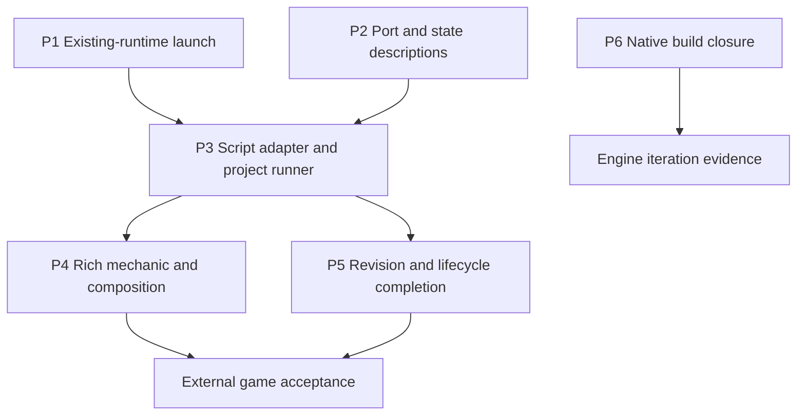

# Execution plan for runtime game authoring

**Basis:** static review of `34f03976b639` on 2026-11-14. These are proposed work packets. Select work in the existing [queue](../../queue.md) and update the owner plans when implementation begins. This file is not a second live task ledger.

## Product completion condition

An author outside the engine repository receives an installed runtime and tools. The author creates a small game, changes its content and a stateful custom mechanic, validates it, runs it, inspects an intentional refusal, reloads it, and packages it. The host binary does not change and the workflow does not invoke a native compiler. The game can use the selected platformer services through supported APIs, without inspecting private engine code.

The compiled Rust module route remains available. Native engine development remains available. Their build operations are explicit and distinct from the normal game-author loop.

## Dependency order



P6 is a parallel engine-development track. It must not block P1-P5. P4 and P5 should share one selected game customer so their interfaces are exercised together.

## P1. Make the existing-runtime workflow reliable

**Owner plans:** [project build and distribution](../project-build-and-distribution.md), [extension model](../extension-model.md), [extension evidence](../extension-iteration-evidence.md).

**Observed:** `run_game.sh` is a Cargo command. The build-label script adds source watches outside the app's selected dependency graph. The module watcher uses fixed Ambition source roots despite accepting a different module package. The existing launch plan already supplies executable path and environment facts.

**Implement:**

1. Add an explicit reuse-only path at the current launcher owner. It runs the selected existing executable and reports build/profile identity. It must not infer a rebuild from changed source files. If no suitable host exists, report that fact and the separate build/install action.
2. Separate engine binary identity, active content generation, executable-module identity, and optional live working-tree display. Keep the compiled binary label stable between actual engine builds. Remove workspace-wide source and Git-index watches as stamp-only invalidation inputs. Preserve content embedding inputs where a selected static distribution needs them.
3. Derive module watch inputs from the selected package and its local dependency inputs. Include the selected game's own sources, manifests, and actual build inputs. Preserve last-good behavior when a module build fails.
4. Expose whether each entry is native or loaded in normal inspection. Reuse `extension_inspect` and the host's admitted-composition view.
5. Keep normal Rust module editing on the already running or reuse-only host. Its linked fallback crate remains a native dependency when a developer intentionally chooses Cargo, so do not claim that the watcher alone prevents all relinks.

**Completion:** run a normal RON edit on an existing host. Run one Mary-O or Smash module edit through the selected watcher. Restart through reuse-only launch and confirm the same selected module artifact is active. Inspect actual process/build work. A content edit or loaded-module artifact replacement should need no host compile/link. A Rust module edit still has its explicit module build. Source-script acceptance belongs to P3.

**Evidence:** warm no-op and changed traces, active engine/content/module identities, and the observed changed behavior. Use the existing measurement owners. A new permanent test that scans shell source for the word `cargo` is not useful evidence.

## P2. Give ports and state one structural description

**Owner plans:** [domain contracts](../extension-domain-contracts.md), [extension state and execution](../extension-state-and-execution.md), [public SDK](../public-sdk-1.0.md).

**Observed:** ports expose typed Rust values and manual wire codecs. The host's offers describe owner, role, and phase. A script converter would otherwise duplicate the record shape. State has primitive values and bounded sequences, with no direct stable-reference, record, or enum form.

**Implement:**

1. Select the ports used by the existing sentry. Add a domain-owned structural description or derive that generates codec and conversion metadata. Keep semantic port cards beside that source. Preserve the existing wire format or introduce an explicitly admitted version; metadata work must not silently change published values.
2. Include exact numeric kinds, finite/bounded values, enum cases, record fields, sequence bounds, optionality, and stable reference kinds. Include units/frames explicitly where relevant.
3. Keep the common SDK free of Bevy and domain implementation dependencies. Each domain owns its port values. The adapter composes only the installed bindings.
4. Add structured inspection over the admitted composition. Text and JSON should render the same model. Include selected host/profile, generation, installed version, role/phase, support requirements, and source/definition context.
5. Add stable reference support when the next customer needs it. Preserve separate authored definition, live body, persistent occurrence, room instance, and request identities. Never use an allocator entity bit pattern as a persisted reference.
6. Extend nested state structure only as required by the selected customer. Keep field tags, canonical encoding, finiteness, and bounds. Do not create a universal property database.

**Completion:** the same sentry port declaration supplies native wire conversion, a script conversion, and a machine-readable description. A deliberate wrong field/type/reference produces a source-located diagnostic. Native and script callers reach the same domain adapter.

**Boundary:** schema output cannot advertise runtime support that the host did not install. Static type/help generation does not prove that a requested action can succeed in the current world.

## P3. Run source scripts and a project on the prebuilt host

**Owner plans:** [extension model](../extension-model.md), [implementation packets](../fast-iteration-implementation.md), [public SDK](../public-sdk-1.0.md), [authoring tools](../authoring-and-tools.md).

**Progress.** The backend (steps 1, 2, 4, 5, 6 of the first list) landed 2026-11-14 (`crates/ambition_extension_rhai`; the sentry's turret). The project entry's first slice landed 2026-11-16: `project.ron` (`ambition.project.v1`: `name`, `content` a pack root, `modules`, `entry_room`) is read by the host's adapter (`game/ambition_app/src/app/project.rs`, `--project PATH`), which lowers it into the existing inputs (`ExtensionModuleFiles`, `select_pack`, `StartRoomOverride`) before any plugin builds; the content watch follows the selected pack's root. The example `examples/projects/sentry_drill` (a manifest and one `.rhai`, no Rust) runs on the built binary: its entry room is the start room, and a syntax error in its script stops the run naming the line. Discovery (step 4 of the second list) landed the same day: the module watcher derives its files from the list at each poll, so a file added to a listed directory or to the list loads, and one taken away leaves and the linked module of its key runs again (one candidate through `stage_module_changes`); the project adapter watches `project.ron` and gives its new module list to the watcher (a manifest that does not load leaves the running project; a new content root or entry room is read at the next start). Witnesses: `a_script_added_to_a_watched_directory_runs_and_removed_leaves` (app_it) and `a_module_added_to_the_manifest_reaches_the_module_list`. The byte source is still the filesystem (the development adapter). The tool context (step 5) landed the same day: `capture_scene`, `inspect_geometry` and `extension_inspect` take `--project PATH` (the windowed builder composes it from the command line; the stepping tools build through `Project::sim`, the project's inputs before Ambition's); `extension_inspect --project examples/projects/sentry_drill` reports the sentry replaced by the project's Rhai script. The completion's witnesses through a project landed the same day: `a_projects_scripted_turret_keeps_its_cadence_through_rollback` (the example project under a GGRS sync-test session: the populated cadence record restores to the script's 0.25 s, the session healthy) and `a_projects_throwing_script_commits_nothing` (the record change and the staged bolt do not commit; the fault names the project's file and generation). Module declarations (step 3 of the first list) landed the same day: a script that defines `fn declare()` brings a module the game does not link (`crates/ambition_extension_rhai/src/declare.rs`: provider and key, schemas with their fields, attachment and save road, entries with phase, trigger, writes, reads, requests, limit and idle policy, ports named by their script names; every entry must be a function of the script), admitted as any module is; `a_module_a_script_declares_runs_with_its_own_record` admits one beside the game's sentry, on the turret's tick, keeping its own record through a sync-test session. It is explicit, not inferred from a run. Initial conditions as prepared data (step 3 of the second list) began the same day with the starting bag: a project lists `starting_items` (catalog ids and counts), the adapter lowers it into `PreparedStartingBag`, and the bag's owner (`StartingBagOf`, and the direct road's `Startup` record) gives every session that bag in place of the game's Rust callback (`with_initial_inventory`); an id the catalog has not is named. Witness: `a_projects_starting_bag_is_its_data` (the listed bombs and lantern, none of Ambition's starter; the control, the example with no list, has the game's bag). Still open: body grants, placements and behaviour attachments as a project's data where a customer needs them (placements already are, in a project's pack), and the decision point (diagnostics, binding ease, state semantics, browser, cost) once a second script customer exists.

**Implement the backend first:**

1. Add a Rhai backend implementing the current `ModuleBackend` contract. Use existing invocation bytes and checked output initially. Keep immutable prepared code cached and mutable invocation data fresh.
2. Resolve imports inside the selected project revision. Parse/prepare source during candidate preparation. No Cargo, generated Rust, or per-script Wasm build belongs in this path.
3. Define module declarations for semantic hooks, attached state, required operations, and limits. Use an explicit compact declaration when call requirements cannot be inferred soundly. Do not infer declarations from one sampled execution.
4. Preserve source positions, call context, and generation identity in faults. Pin runtime version, math/configuration, imports, and binding versions in executable identity.
5. Keep time, RNG, module variables, and captured mutable host objects out of hidden persistent state. Bind functions to staged requests and immutable observations, not to mutable ECS access. Set deterministic interpreter limits and separately bound native query work and result sizes; one host call can exceed one interpreter operation's worth of work.
6. Translate the existing stateful sentry through the same host and domain paths. Keep separate turret cadence and outcome semantics. This is the first backend proof; it avoids waiting for every new body/custody port.

**Implement the project entry:**

1. Define a small manifest that selects an installed runtime/profile, content pack roots, behavior modules, assets/publications, entry route, and scenario settings. Reuse the existing `pack.ron` formats for content; the project manifest joins them.
2. Implement one native project adapter that lowers those values into the existing `ModuleDraft`, provider, and preparation lifecycle. That adapter is part of the host. An author must not implement another Rust `GameModule` for each game.
3. Replace required Rust callbacks for ordinary initial conditions with prepared data or supported module lifecycle hooks. Initial inventory, body grants, placements, and behavior attachments must use their existing owners. Advanced native callbacks remain part of the native SDK.
4. Discover modules from the manifest, including additions and removals. Use an artifact byte source that can later serve packaged and browser content; do not standardize colon-separated filesystem paths as the project contract.
5. Reuse the tool catalog and owner commands for validation, headless run, inspection, and capture. Add a thin project context where needed rather than rewriting the tools.

**Completion:** an external project contains no game Rust source or build script. An already built host runs it. Editing a sentry rule changes its behavior; invalid source preserves the active program. A real rollback witness restores populated state. Add one focused invocation-fault witness: a script changes its local record and stages a request, then raises an exception or exhausts its deterministic budget. That invocation must commit no canonical record changes or requests, and its diagnostic must identify the source and generation. A no-compiler environment is useful evidence for this workflow; an unchanged binary hash alone is insufficient evidence about process invocation.

**Decision point:** assess diagnostics, ease of binding, state semantics, browser compatibility, and runtime cost. If the Rhai prototype fails a concrete requirement, compare Luau on the same sample and target. Do not build several production language adapters in parallel.

## P4. Prove rich composition with existing game requirements

**Owner plans:** [domain contracts](../extension-domain-contracts.md), [actor effects](../actor-effects-and-modifier-composition.md), [capability composition](../capability-and-runtime-composition.md).

**Main customer:** Primeval swallows that fetch and carry coconuts together. Preserve the native item custody and control authorities. This mechanic is a named game algorithm, so its coordination policy should live in game script rather than a new swallow-specific engine port.

**Implement:**

1. Separate controller hooks from attached body behaviors. Control ownership determines which controller may publish intent. It does not determine whether an attached physical behavior exists.
2. Expose immutable frame-aware body facts and bounded, scoped item/actor observations. Provide stable IDs and deterministic iteration. Keep world-wide knowledge separate from a controller's permitted knowledge.
3. Add item-custody requests through the existing item owner and structured result observations. Include supported-carry establishment/teardown and safe release: Primeval currently takes the item and installs `SupportedCarry`, then removes that relationship after release. Preserve the existing native identity/remapping and carrying geometry. Keep native conflict resolution for two attempts to take one object. A script records an attempt on submission and success only after a result.
4. Expose the common control-intent operation. Preserve normal action gates, body capabilities, and coordinate frames. Avoid a new direct position/velocity writer that bypasses physical admission.
5. Migrate cooperation with its deterministic ordering and reservations. Choose a coordinated room/session invocation or an explicit domain protocol. Independent callbacks must not each assume they own the same coconut.
6. Use the state schema for goal/partner/item references, phase, and elapsed simulation time. Reuse host rollback. Remove the old production producer when the new path is authoritative; a native reference may remain in a focused test where useful.

**Bounded parallel customers:**

- Move ordinary form dimensions and pose selection into prepared data. Route ordinary posture/form requests from human gestures, AI, scripts, and moves through the same collision-safe resize. Report clearance rejection. Move-owned absence from the stage retains its admitted semantic transition and arrival policy; it is not a generic resize.
- Complete typed source-owned numeric effect instances for current Speed Shoes/equipment/gravity customers. Give each source explicit stacking/expiry and supported motion-policy semantics. Keep existing ability and invulnerability owners.

**Completion:** the coordinated mechanic runs with a refused pickup, a cooperating pair, and room/lifetime cleanup. Preserve Primeval's current safe release when a partner becomes driven; its cooperative AI availability intentionally excludes that body. A separate attached-body behavior witness demonstrates attachment survival across a controller change. The form customer changes compact-form dimensions without a native enum edit. Two numeric effect sources can expire independently and rewind across expiry. Use the narrow existing production-path tests that cover these transitions; do not build a broad source-policy framework.

## P5. Complete revision, persistence, and target loading

**Owner plans:** [content generation and reload](../content-generation-and-reload.md), [extension state](../extension-state-and-execution.md), [project build/distribution](../project-build-and-distribution.md).

**Implement:**

1. Prepare the selected project's code, data, schemas, imports, and binding identity as one candidate. Coordinate the existing pack and module replacement paths under that selection. Do not invent another rollback or publication authority.
2. Add body/persistent-occurrence or room state save roads only for the selected lifetime promise. Reuse the existing checkpoint/durable world owners. Admission must continue to reject unsupported lifetime/save pairs.
3. Define reference handling on unload, destruction, restoration, and migration. A reference to an unloaded persistent occurrence is distinct from a missing live body. Use normal persistence semantics to resolve it.
4. Use App/session-owned generation handles in the reusable SDK/demo path. Replace immortal publication semantics with explicit retained handles. Main Ambition's App-local `Arc` selection supplies an existing model.
5. Load script/module bytes through native, packaged Android, and browser asset providers. Verify actual target execution; a successful native build with the same profile is not browser acceptance.
6. Preserve existing local mechanical-edit and remote generation policies. Mechanical edits may reconstruct a known scenario. Do not silently overwrite a durable save, erase unrelated progress, or promise arbitrary migration of any live state.

**Completion:** change a script and the content shape it uses together. Either the pair activates or the old pair stays active. A refused candidate leaves the running generation usable. The chosen script state survives each lifetime that the SDK advertises. Repeated reloads retire unreferenced generations. The selected packaged targets load the intended behavior and report its identity.

## P6. Improve native engine builds through complete dependency cuts

**Owner plans:** [public SDK](../public-sdk-1.0.md), [architecture reassessment](../architecture-reassessment-and-composable-multiplayer.md), [project build/distribution](../project-build-and-distribution.md).

**Implement:**

1. Use the independent headless fixture to select one meaningful minimal body/world profile. Inspect its actual Cargo feature/dependency resolution. The audit's lower-bound graph is only a locator.
2. Select one unwanted domain and trace every dependency parent, construction contribution, restore contribution, observation type, and schedule adapter that pulls it in.
3. Move cross-domain integration to composition and gate dependencies with the same capability boundary as installation. Keep the domain's state, validator, runtime, and lifecycle internally coherent.
4. Move physical developer-key policy and its reader out of the shared foundation. Preserve the semantic action message. Make keybindings runtime settings.
5. Separate camera request/value contracts needed by lower layers from presentation implementation. Preserve existing tuning resources. Trace consumers before moving APIs.
6. Consider pure domain schema/value extraction for validator bootstrap where a concrete import reaches runtime systems. Ship the prebuilt validator now; do not wait for every extraction to remove compilation from the author loop.

**Completion:** a useful body/world run still works, and the selected absent domain leaves the external consumer's resolved closure. Record changed compilation units and actual edit-to-run timing. Further generic/code-generation, crate, linker, or cache work follows the dominant measured cost.

Avoid generic splitting of `actor_monolith`, a large matrix of all features, a universal dynamic registry, or a new process guard for every dependency fact. The source already has optional render/rollback paths, mold, incremental development builds, and aggregated tests. Repeating those recommendations has no payoff.

## Measurements and acceptance evidence

Use existing measurement and harness owners. A receipt should state the engine revision, host/profile, target, toolchain where applicable, project generation, source change, observed outcome, and elapsed phase times. Record fresh and warm preparation separately.

| Scenario | Main observation | Why it matters |
| --- | --- | --- |
| Change one authored move/tuning value | Save to first changed simulation result, no native build | Ordinary data loop |
| Change one stateful script branch | Parse/admit/reconstruct/first-result times; populated state behavior | Procedural loop |
| Add/remove a script module | Correct discovery and lifetime cleanup | Project completeness |
| Change code and related content together | Coherent accepted generation or complete refusal | Publication correctness |
| Change one native domain implementation | Cargo unit/codegen/link cost and first useful run | Engine-development loop |
| Run the same game on actual browser/mobile targets | Selected code and state behavior through target loading | Deployment contract |

Existing command entry points include:

```bash
python3 scripts/agent_query.py "extension content generation scripting"
python3 scripts/measure/compile_cost.py --help
python3 scripts/agent_query.py tools "headless inspect capture"
```

The compile-cost tool deliberately changes a clean probe file and builds. It was not run for this static audit. Inspect target storage and coordinate native builds before using it, as the repository guide requires.

The product comparison with Godot should use the same game task, supported asset inputs, and a clearly described model/tool budget. Record successful behavior, repair iterations, private-source dependencies, and total waiting. Do not turn language choice, line count, or number of CLI commands into a substitute for a working game.

## What should remain out of the first campaign

Keep the first campaign focused on one language, one project format that joins existing formats, one external game, and the domain operations it needs. A visual editor, public mod marketplace, a new scripting language, arbitrary native DLL reload, a universal ECS reflection API, and complete live heap migration are separate projects. They do not need to be solved to remove native builds from normal game creation.
